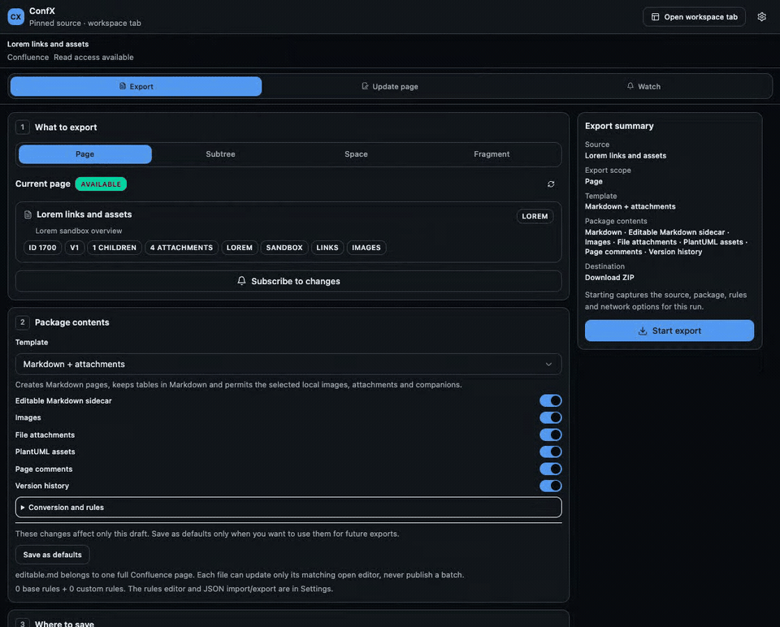
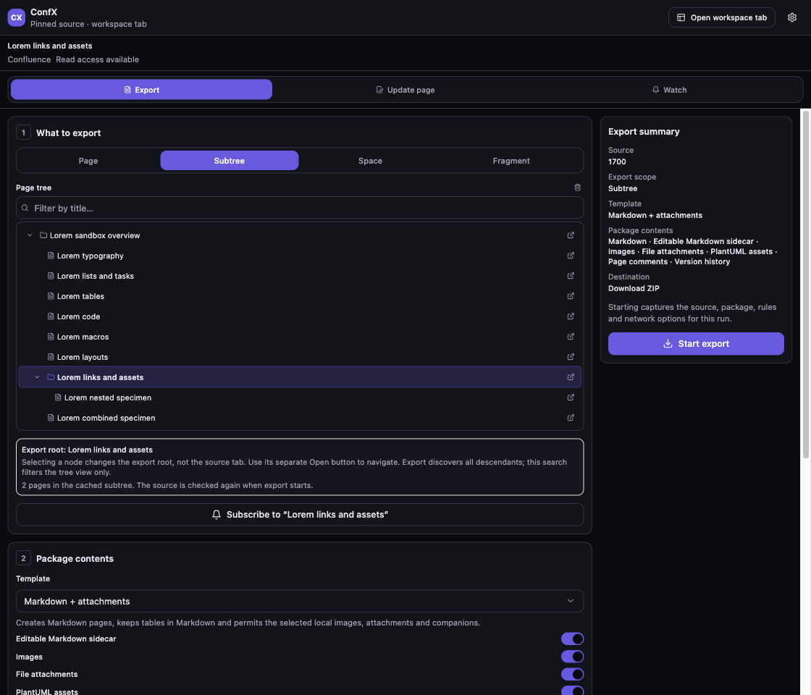

# ConfX

> Browser extension for exporting Confluence and Jira content to Markdown, CSV, images, and ZIP archives. Works through your active browser session -- no separate API token required.


[Русская версия](README.ru.md)

| Field             | Value                                                        |
| ----------------- | ------------------------------------------------------------ |
| Status            | Active                                                       |
| Type              | Browser extension / host-page extraction tool                |
| Host browsers     | Chrome / Chromium, Yandex Browser                            |
| Primary stack     | Manifest V3, React 18, TypeScript, Vite, Tailwind CSS |
| Release artifacts | `confx-chrome.zip`, `confx-yandex.crx`, `SHA256SUMS`         |

<details>
<summary>Animated export demo</summary>

Real subtree export in a normal workspace tab, using the isolated Lorem sandbox.
No native side-panel or OS-dialog capture.



[Static screenshot](docs/screenshots/r2-workspace-en.png)

</details>

## What ConfX exports

ConfX writes the same package contents to a browser ZIP download, a fresh folder, or a ZIP streamed directly to disk:

```text
confluence-page.zip
  index.md                 # single-page and block exports stay at archive root
  manifest.json            # manifest v2: source, page inventory, outcomes, failures
  pages/
    123456/
      index.md             # watch-changed pages use stable ID-namespaced folders
      tables/
      images/
      attachments/
      comments.json
      history.json
```

- **Markdown** -- main page or issue content converted from Confluence/Jira HTML.
- **CSV** -- extracted tables, one file per table.
- **Images** -- inline images downloaded from the host, deduplicated when enabled.
- **Attachments** -- page attachments up to the configured size limit.
- **Comments** -- page and inline (fragment) comments with authors, resolved status, replies, and attachment references are stored in one `comments.json`; `index.md` contains only the page, while comment-owned files are stored under `attachments/comments/<comment-id>/`.
- **manifest v2** -- `manifest.json` (or `space-manifest.json` for a space export) keeps the existing export type, timestamp, preset, source and counts, plus a canonical `pages` inventory. Each page record includes ordered ancestors, parent ID, archive path, origin and verified attachment outcomes. List/download failures are recorded without counting missing files as archived.

### Export presets

- **Markdown + attachments** -- creates Markdown pages, keeps tables in Markdown, downloads inline images, and includes page attachments when enabled.
- **Markdown only** -- creates Markdown pages and keeps tables in Markdown. Images and file attachments are not downloaded.
- **CSV tables only** -- creates CSV files for real user tables plus a per-page service `index.md` listing the written CSVs. Readable page content, editable files, images, attachments, comments and history are excluded.

### Reading fidelity

Rendered HTML is converted as HTML, not reinterpreted as Jira wiki markup: route placeholders
such as `{code}` remain literal. PRE regions retain all text, inline-code siblings, BR line
breaks and meaningful whitespace; explicit language metadata takes precedence over decoration
classes. Literal XML/generics remain text in paragraphs, links and table cells.
Explicit `<p class="code-fence">` wrappers containing CODE retain multiline code and literal link text.
Code blocks inside GFM tables use escaped HTML PRE/CODE rather than invalid nested fences,
preserving line breaks and indentation. Nested CODE does not introduce visible backticks.
Plain-text package versions and email addresses are not turned into email links; explicit
HTML links remain clickable.
Known hidden extension settings and collaboration decorations are omitted without deleting
visible JSON examples. Heading-number previews appear only in the reading projection.
Wiki destinations outside the archive become absolute online URLs, including when local
page-link rewriting is disabled. Already-fragmented code is not guessed or reassembled.
These reading-only corrections do not change existing editable v1/v2 projections or import
conflict checks.

## Autonomous Lorem sandbox

Run `npm install` and `npm run sandbox`, then open <http://127.0.0.1:4177/>.
The loopback-only laboratory provides synthetic pages, a real self-hosted TinyMCE editor,
local published/draft state, attachments, conversion traces, reset and conflict scenarios.
Codec limits: 1.5 MiB source, depth 128, 40k nodes, 2 MiB bodies; task/macro/resource
placeholders stay opaque. Draft saves pin their base revision and never silently rebase.
Use the actual unpacked Confx extension to export a page or subtree and reimport edited MD.
No work exports, Atlassian account or Docker installation are required.

This is an independently implemented compatibility contract, **not a Confluence server**.
It does not certify Atlassian conversion behavior or arbitrary Marketplace apps.
See [the sandbox guide](sandbox/README.md) for the component catalog, safeguards, TinyMCE
licensing and `test:sandbox` / `test:sandbox:e2e` checks.

### Synthetic-only fixtures

`npm run check:privacy` checks authored HTML/data fixtures and sandbox samples for local
home paths, non-example emails, authenticating token/cookie samples, captured account
metadata and non-allowlisted external URLs. Use independent Lorem examples, reserved
example domains or loopback; public XML namespaces and PlantUML endpoints are narrowly
allowlisted. The check reports locations and rule codes, never matched values.
It is a current-fixture guard, not proof that Git history, media or release archives
are clean. Do not put real page captures or credentials into fixtures, notes or reports.

## Workspace and export ownership

- **Export**, **Update page**, and **Watch** are independent sections. Export scopes
  include Page, Subtree, Space, Fragment and the Jira Issue/Search forms.
- Drafts are separate for each source tab, product and canonical site base. Moving
  to another page on the same source updates its card without resetting the selected
  scope, subtree root, filters or expansion. Selecting a tree row chooses the export
  root; its separate **Open … in the source tab** button navigates the wiki.
- Workspace metadata survives UI reload within the browser session. Loaded editable
  files and their diffs stay in the open UI's memory across section changes, not in
  workspace/job snapshots. Reloading or closing that UI requires loading the file again.
- One package export owns the extension-wide lock through download completion and
  cleanup. Its status remains visible across sections. Another UI can inspect it and
  **Go to job**, but only its live owner can cancel it. Closing/reloading the owner
  aborts best-effort; a lost owner is **interrupted**, never automatically resumed.
- **Open workspace tab** opens a normal extension tab pinned to the current source.
  An extension tab without an explicit valid source pin cannot adopt an arbitrary
  active wiki or start an export. Missing source access does not reset the saved draft.
- The production **Export Composer** follows **what → package contents → destination →
  summary → Start export**. Package controls are shared across scopes; unavailable options
  are disabled with explanations. Scope forms do not own another preset or job widget.
- A panel can run a quick single-page ZIP. Multipage starts and either disk destination
  offer **Continue in workspace tab**. The new normal tab restores metadata, not a live
  job or selected file; review the draft and start there. A missing pin can be replaced
  only by explicitly choosing an open source tab.



### Three destinations and cancellation

- **Download ZIP** retains compressed chunks in memory and opens the browser Save dialog
  after packing. **Export ready** means the browser download completed, not just that a
  download ID was returned. Cancellation after handoff requests `downloads.cancel`; a
  still-open Save dialog may need to be closed by the user.
- **New folder** calls the native parent-folder picker before asynchronous extraction,
  in a normal workspace tab. It creates a fresh `<safe-actual-package-root>-<job-UUID>`
  directory, never reuses or clears an existing export. `.confx-export.json` tracks the
  running/terminal state and raw confirmed file/byte counters. A cancel or failure stops
  new writes, aborts the current writable where possible and keeps already closed files
  with a cancelled/failed marker. There is no recursive deletion or rollback. A package
  with optional-resource failures is marked partial; `running` after owner loss is unfinished.
- **ZIP to disk** calls the native parent-folder picker before asynchronous extraction
  in a normal workspace tab. It creates a new `<safe-actual-package-root>-<job-UUID>.zip`
  in that folder, using the actual package root reported by the producer, not the draft
  name hint. ZIP bytes stream with backpressure; **Export ready** appears only after
  the encoder finishes, all writes drain and the writable closes. Cancellation or
  failure may leave this new ZIP incomplete; it is not deleted or reported as ready.
  An existing file or folder with the generated name causes a destination collision
  before opening a writable: nothing existing is reused, cleared or overwritten.
- Both ZIP modes share the fflate ZIP32 encoder. Conservative sentinel-safe limits are
  65,534 entries and `0xfffffffe` bytes for ZIP size/offset counters; exceeding a limit
  fails explicitly with `ZIP_LIMIT_EXCEEDED`. The folder mode has no artificial ZIP32 cap.
  Permission denial, picker cancellation, unsupported APIs and writer errors never
  silently fall back to a different destination.

Disk destinations require a secure normal extension tab and the relevant browser API.
OPFS automation exercises real handles/writables but is not evidence of native OS-dialog
support. The native acceptance scope for this candidate is documented under Browser support.

Streamed ZIP deliberately does not use `showSaveFilePicker`. The normative algorithm
in the [WICG File System Access specification](https://wicg.github.io/file-system-access/#api-showsavefilepicker)
empties an existing selected entry before returning its handle. This is not a
Vivaldi-specific bug, and aborting a later writable cannot undo that picker step.
Choosing a parent folder and creating a uniquely named new ZIP avoids selecting an
old file altogether. Ordinary **Download ZIP** still uses the browser Save dialog.

The browser API has no atomic exclusive-create operation. UUID naming, an existence
check and the extension's export lock prevent reuse by Confx runs; they do not promise
protection against an external process deliberately racing the same generated name.

### Sequential packages and completeness

Confluence pages are prepared and written one at a time. After each successful write,
only committed page/asset metadata remains; the ordinary ZIP download also retains its
compressed output. This is not a promise of one-file memory: the converter still holds
the current page and its resources.

With deduplication enabled, generic images and attachments share the first actual path
for matching bytes and extension. Name collisions receive distinct safe paths; comment
owners and PlantUML source/image pairs remain separate. Links to previous committed pages
and the current prepared page may be local. Forward links to unconfirmed pages stay online,
and already written Markdown is not rewritten later.

An exhausted page-source failure stops the run: no incomplete ZIP is offered as a ready
download. Individual missing or oversized resources may instead produce a partial package;
their links stay online and the manifest records the omissions. Cancellation also covers
queued requests, retry waits and response-body consumption.

Space/label and child-page collection reads continue until an empty response, including
short batches; repeated IDs are a pagination error, not successful completion. Tree and
Watch discovery no longer silently stop at 5,000 children. Jira search retains its existing
one-page, 50-issue limit and aggregate Markdown/JSON/CSV outputs.

## Export defaults and one-off options

An export template is a starting policy, not a command to overwrite settings. Package
toggles are visible in **Package contents**; **Conversion and rules** expands conversion
options. Depth is shown for subtree/space exports. Those changes affect the current draft
only; **Save as defaults** is the explicit persistence action. An already prepared run
keeps its own source, rules and network options even if settings change.

- **Markdown + attachments** permits the selected resources and companions.
- **Markdown only** disables images, attachments and PlantUML assets. Editable sidecars,
  comments and history remain separate choices.
- **CSV tables only** writes CSV plus a service `index.md` linking that page's CSVs,
  not readable page content, editable files, resources, comments or history.
- Empty depth means unlimited; zero means the subtree root only. Tree discovery
  concurrency and HTTP request concurrency are independent limits.
- **Fragment**, for every product, omits editable files and page attachments/comments/history.
  Valid selected images and PlantUML assets remain template-controlled. Jira Issue/Search
  uses description, comments and attachments, with online issue links rather than
  Confluence page-link rewriting; its tables-only output is issue-metadata CSV and an index.

Settings schema v6 keeps the v4→v5 migration of export options into `exportDefaults`,
including custom rules and unlimited depth rather than the old unused cap.
Only v5→v6 adds the appearance palette; it does not rebuild export defaults.
Rules JSON version 1 retains the actual base/custom rules; older versionless Options
exports are accepted at the input boundary. Importing a preset ID does not replace its rules.
The advanced Confluence base override must match the source origin and path; otherwise
ConfX keeps the detected base and displays a diagnostic. Online viewer resources stay
online rather than pointing to uncreated archive files.

### One settings surface

The header **Settings** button opens the extension options page, not a fourth workspace
section. It contains **Export defaults**, **Appearance and language**, **Page launcher**,
collapsed **Advanced: network and rules**, and **Diagnostics**. Advanced retains separate
tree-discovery/HTTP concurrency, retry/timeout controls, same-origin base override,
custom-rule editing and rules JSON import/export.

Appearance has two independent choices: **Light / Dark / System** and **Violet / Blue /
Forest / Graphite / Amber**. Preview cards use the real interface colors. Changes apply
without reload to the workspace, settings, viewer and page launcher, never the host page.
System follows the OS while it is selected; existing Light/Dark preferences keep Violet.
The default remains Dark + Violet. If saving fails, the previous choice stays active and
the settings page offers a retry.

The toolbar icon is a flat document/export symbol, rasterized separately for 16–64 px.
It follows the selected mode and palette immediately. System mode reads the initial OS
scheme using a one-shot `offscreen` document, then closes it. Live updates come from a
visible HTTP(S) tab with Confx's content script or a visible ConfX window, without polling.
If only browser-internal pages are visible, System refreshes when an eligible page opens.
The browser's extension-manager icon remains the static Dark + Violet artwork.

Diagnostics are downloaded only by **Export safe diagnostics**. The visible composition
includes extension/manifest versions, API capabilities and a projected export status,
phase and allowlisted reason code. No page bodies, source URLs/IDs, titles, filenames,
files, rules, settings payloads, headers, credentials or raw errors are exported.

## Edit a page locally in Markdown

1. Open the Confluence wiki page in **edit mode**, then open ConfX → **Update page**.
2. Click **Export editable MD**. This downloads one `.editable.md` file; no JSON probe,
   ZIP extraction, DevTools, or separate workbench is needed.
3. Edit that file in your IDE. Keep the hidden `confx:` comments: the file embeds the
   original editor HTML and block mapping needed to preserve macros and formatting.
4. Choose the edited MD or drag it into the upload area in **Update page**. Click
   **Apply to editor**, then **Confirm changes** inside ConfX. The update is one undoable
   editor operation; a browser confirmation dialog is not required.
5. Publish with the page's normal **Save / Update** button. Applying real changes can
   trigger Confluence's normal draft autosave; ConfX does not publish automatically.

File selection is local and does not require site access; applying it requires the
matching source editor. Changing the source tab/base/page clears the loaded file and
confirmation rather than offering another page's edit.

In Vivaldi Web Panels, native file dialogs can fail due to browser regression
[VB-133104](https://forum.vivaldi.net/topic/122145/side-panel-cannot-access-the-file-picker-dialog./4).
Use **Choose file in workspace tab**, then choose the file in the normal tab and perform
diff/confirm/apply there. Opening that tab does not automatically launch a picker; no File
or HTML is transferred back through session storage. Drag-and-drop remains available
where it works. Neither file-URL access nor disabled browser security is required.

The handoff is available in native panels and popups. Only a real normal browser tab
gets workspace-only file-system capabilities; Vivaldi's hidden panel pseudo-tab is not
a workspace.

Export and file loading do not change the editor. An unchanged file is a no-op. If the
file belongs to another page/site or the editor changed after export, the update is
refused rather than overwriting newer edits. No test edits or temporary pages are created.

This workflow targets the Confluence TinyMCE editor (`wysiwygTextarea_ifr`), including
wiki pages linked from Jira; it does not modify Jira issue fields. Applying editable
Markdown is limited to one already open editor, not a multi-page publishing operation.

Normal Markdown edits include text, emphasis/inline code, safe links, heading levels,
paragraph insertion/removal, lists, table row/column changes, and fenced-code language.
Keep the `confx:` identity comments even when deleting all content inside a mapped region.
New Markdown may also be inserted between mapped regions without creating new block IDs.
Untouched source ranges, protected macros, and hidden settings remain byte-identical.
Simple edits patch the original HTML directly; structural edits rebuild only the changed
normal region and retain compatible source attributes. Protected-macro edits, unsafe HTML,
damaged/reordered identities, and ambiguous edits across existing inline styles are refused
without partial application. Keep files private: each includes the complete original
document. Total file size is limited to 35 MiB, with 5 MiB of editable Markdown.

New direct-editor files use `confx-editor-markdown/2` with a `confx-roundtrip/2` source
package. Literal text is safely escaped, and marker framing preserves meaningful spaces,
NBSP, tabs and code whitespace. Keep the framing blank lines around identity comments.
Declared v1 files remain readable with their original validated baseline and mapping.
Re-export to obtain the new projection; a protected v1 table is not silently reinterpreted.
Structures represented by `[Confx protected …]` remain read-only, including standalone lists
and merged tables. New lists can be inserted into editable regions or gaps, but a standalone
list becomes protected when the resulting page is exported again.

### Editable files in full-page ZIP exports

Page, subtree, space and watch-changed exports can include **`editable.md`** beside each
page's ordinary **`index.md`** for both Markdown templates when enabled and safe.
Exporting these files reads published page content; it does not open editors, create drafts or publish pages.

1. Extract the ZIP and edit the required page's `editable.md`, not its reading `index.md`.
2. Keep the hidden `confx:` comments. Each editable file is self-contained and can be
   moved independently of the archive.
3. Open that page in edit mode and load or drop the edited file into **Update page**.
   Review the diff, apply and confirm, then publish with Confluence's own button.

New bulk files use **`confx-storage-markdown/2`**; declared v1 files remain supported.
They embed the original `body.storage`, page identity, published version and SHA-256;
trusted mappings are regenerated from that source on load. Native paragraphs, headings,
tables and pre/code regions reuse source-preserving Markdown editing.
Simple rectangular tables with native TH headers or an explicitly bold TD header row are
editable; changes retain native TD/TH tags, bold wrappers, classes and background attributes.
Auto-numbering preview attributes and hidden settings stay in the untouched source rather
than becoming literal heading numbers in editable Markdown.
Layout-cell content can be edited without rebuilding its wrappers. Unknown structures, Confluence macros
(including code macros), resource links/images, standalone lists and merged tables are
protected. Ambiguous insertions across layout cells or container boundaries are refused.
Untouched Storage ranges retain their exact bytes during local patching.

Before applying a Storage file, ConfX checks the published version and original source,
then compares the open draft with that baseline through page-context body conversion.
The proposed editor HTML must convert back to the complete intended Storage structure,
including macro parameters. Conversion loss or unsupported server conversion blocks the
update; direct export from the open editor remains available. The live editor is checked
again at the write boundary. Conversion requests do not save or publish content.
An unchanged file never modifies the editor.

Full originals are **not** embedded when any enabled rule skips content or removes a table
after CSV extraction, even if its selector does not currently match. CSV-only and fragment
exports do not gain reversible files. Missing identity/version/source or invalid/unsafe XML
also suppresses the sidecar without aborting the reading export. Manifest v2 records each
page's versioned `editable` capability, path/source hash when available, or the reason:
`filtered-content`, `partial-export`, `source-unavailable` or `invalid-source`.
Native Storage and editable Markdown are each limited to 5 MiB; the complete file to 35 MiB.
This is bulk **export**, not automatic bulk publication.

Previously downloaded ZIPs are not modified by updating the extension. Re-export a section
to obtain corrected reading Markdown and v2 editable files.

## Features

- **Page export**: export the current Confluence page as Markdown, CSV tables, images, comments, and a manifest.
- **Page layouts**: preserve standard Confluence layouts and their export markers; editable sidecars retain the protected source needed for one-page editor updates.
- **Space export**: export all pages in a Confluence space when the current page context supports it.
- **Subtree export**: recursively export child pages and generate a navigable `README.md`.
- **Picker**: select a block on the page, preview it, and export only that block.
- **Watch** _(experimental)_: track saved snapshots and inspect changes over time.
- **Jira support**: extract useful Jira issue content when the current tab is a Jira issue.
- **Rule engine**: configure section/table extraction rules for Confluence page conventions.

## Single-page update boundary

ConfX has no bulk Markdown publishing route, page creation/update publisher, attachment
upload workflow or publication rollback. Reading/exporting a subtree or space remains
supported; its editable sidecars are applied individually to matching open editors.
Only the user publishes with Confluence's own button. Read-only storage/editor conversion
may use POST; that is not a REST write to published content.

Legacy recovery records under `chrome.storage.local` key `cx.import.run.v1` are not read,
resumed or automatically deleted. They may be the only record of an earlier partial
publishing run and should be reviewed privately rather than discarded.

## Page detection and floating buttons

ConfX injects a content script on HTTP/HTTPS pages, but the floating **Open in ConfX** button is shown only when the page is detected as Confluence or Jira.

- Confluence detection prefers Atlassian metadata such as `ajs-page-id`, then known Confluence URL routes.
- Jira detection prefers `ajs-issue-key`, then known Jira issue routes such as `/browse/KEY-123`.
- Generic paths that merely contain values like `ABC-123` are ignored to reduce false positives.

The compact launcher can be moved by dragging (6px threshold); it snaps to the nearest
edge with a 12px inset and stays in the viewport. **Enter** opens ConfX, **Shift+F10** or a
context click opens its menu, and **Esc** closes it. Hide it until this tab reloads, hide
it on this site, or reset its position. SPA rerenders do not undo a tab-only hide.

**Settings → Page launcher** provides live global Confluence/Jira toggles and local
site restore/reset. Site visibility and position use `storage.local` key `cx.launcher.v1`,
not sync. Restore preserves position; resetting site settings removes its override but
does not undo a tab-only hide before reload. The toolbar and workspace remain accessible.

## Watch storage

Watch subscriptions are stored locally in the browser profile. They are not sent to a remote service.

- Storage area: `chrome.storage.local`.
- Troubleshooting key: `cx.subscriptions.v1`.
- Each subscription stores a baseline snapshot plus a bounded local check history.
- Accepting changes updates the baseline snapshot but keeps recent check history.

When a check finds added or changed pages, ConfX can export the selected changed pages using the shared package/destination options and include a `watch-diff.json` report. Panel users continue in a workspace tab and reopen Watch to export the retained selection. Removed pages are reported but not fetched for content export.
Changed pages are stored as `pages/<page-id>/index.md`, so two pages cannot overwrite the same Markdown or asset paths.

## Security and privacy

> ConfX reads Confluence and Jira content through your **active browser session cookies**. A separate Confluence or Jira API token is not required.
>
> Development builds currently request **broad HTTP/HTTPS host access** (`https://*/*`, `http://*/*`). Install only trusted release artifacts and always verify checksums against `SHA256SUMS` from the same GitHub Release.
>
> ConfX never injects into browser-internal pages such as `chrome://extensions`. If Chrome withholds access to an HTTP(S) site, the side panel keeps URL-based detection and offers a user-initiated request for that exact current origin only. It never expands the request to all HTTP/HTTPS sites as error recovery.
>
> Rendered Markdown in the viewer is sanitized to passive HTML, editor updates are injected only into the browser-validated document of the open Confluence editor, and console logs never contain resource URLs, attachment titles or raw errors.

## Install from GitHub Releases

Chrome Web Store publishing is intentionally out of scope for now. GitHub Releases are the distribution channel for the current release flow.

### Chrome / Chromium

1. Download `confx-chrome.zip` and `SHA256SUMS` from the same release.
2. Verify the checksum: `sha256sum -c SHA256SUMS --ignore-missing`.
3. Unzip `confx-chrome.zip`.
4. Open `chrome://extensions`.
5. Enable **Developer Mode** (toggle in the top-right corner).
6. Click **Load unpacked**.
7. Select the extracted folder that contains `manifest.json` at its root.

### Yandex Browser

1. Download `confx-yandex.crx` and `SHA256SUMS` from the same release.
2. Verify the checksum: `sha256sum -c SHA256SUMS --ignore-missing`.
3. Open `browser://tune`.
4. Drag `confx-yandex.crx` into the browser window.

## Usage

### Export a Confluence page

1. Open a Confluence page in your browser.
2. Open the ConfX side panel (click the ConfX icon in the toolbar).
3. Choose **Export → Page**, review the template/package and **Download ZIP** destination.
4. Click **Start export**.
5. Save the generated ZIP and wait for **Export ready**.

### Export a block with the picker

1. Open a Confluence page in your browser.
2. Open ConfX → **Export → Fragment**, then click **Start picker on page**.
3. Hover over the page to highlight the target block. Use `[` / `]` to adjust the selection level. Press `Esc` to cancel.
4. Click the block to select it.
5. Review package and destination, then click **Start export**.
6. Save the ZIP, or continue in the workspace tab for a disk destination.

### Export a Jira issue

1. Open a Jira issue in your browser.
2. Open the ConfX side panel (click the ConfX icon in the toolbar).
3. Choose **Export → Issue**, review package and destination, then click **Start export**.
4. Save the ZIP. **Search** uses JQL and continues in a normal workspace tab.

## Requirements

- **Node.js 22.12 or later** (required by Vite 7; matches the CI workflow).
- **npm** (bundled with Node.js).
- **Chrome / Chromium** -- for Chrome local builds and smoke checks.
- **Yandex Browser** -- for Yandex CRX smoke checks (optional).
- **Existing Yandex signing key** -- required only to sign CRX packages; unsigned builds use the pinned public extension identity.

## Local development

```sh
npm install
npm run dev
```

Chrome development build:

```sh
npm run build:chrome
```

Load `dist/` from `chrome://extensions` with Developer Mode enabled.

Unsigned Yandex development build uses the existing pinned public extension identity:

```sh
npm run build:yandex
```

Signed packaging requires the existing private signing key (`YANDEX_KEY_PATH` or local
`keys/yandex.pem`) and configured `YANDEX_EXTENSION_ID`. Do not generate or replace a key
to bypass a missing prerequisite: that changes the extension identity. Public manifest
key material is not a credential.

### Export module boundaries

`src/lib/export/confluence.ts` and `jira.ts` own content orchestration.
`package-writer.ts` owns package layout, `zip-encoder.ts` shares fflate encoding,
and `paths.ts` owns safe archive names. Producers return archive results without
importing React or browser download UI. Progress callbacks use `export/contracts.ts`;
source metadata, progress rendering and the browser handoff (`sidepanel/download.ts`)
remain UI concerns. ZIP output is built from compressed chunk parts without a second
whole-archive concatenation and copy.

## GitHub Actions distribution

`0.3.0` is the current stable release. See the [changelog](CHANGELOG.md) and the
[release checklist](CONTRIBUTING.md#release-checklist) for the next one.

The release workflow first checks stable numeric `X.Y.Z`, equal package/lock root
versions and exact `vX.Y.Z` tag equality (including tag-selected manual dispatch).
It then runs reusable R2 verification: privacy, typecheck, unit/sandbox contracts,
lint/format, a fresh Chrome build with actual-extension E2E and unsigned Yandex build.
Branch dispatch stops at verification and the Chrome artifact; matching tags also
enable Yandex signing and GitHub Release publication. Tag/push/release need separate
authorization; workflow code is not evidence that remote checks have passed.

Required secret and release variable:

| Name                         | Type                           | Purpose                                                    |
| ---------------------------- | ------------------------------ | ---------------------------------------------------------- |
| `YANDEX_CRX_PRIVATE_KEY_B64` | GitHub Actions secret          | Base64-encoded private signing key for `confx-yandex.crx`. |
| `YANDEX_EXTENSION_ID`        | Workflow env / secret override | Expected Yandex extension ID.                              |

Only signed Yandex packaging needs the private key. Its job writes the existing key into a temporary file, validates the computed extension ID and removes the file at the end. Missing signing material blocks CRX packaging; it is never replaced with a generated key.

## Browser support

| Capability                  | Chrome / Chromium          | Yandex Browser                           |
| --------------------------- | -------------------------- | ---------------------------------------- |
| Manifest V3                 | Supported                  | Supported                                |
| Primary UI                  | Side panel                 | Popup fallback / compatible extension UI |
| `side_panel` manifest entry | Present                    | Present for compatibility                |
| `action.default_popup`      | Not included               | Included in the Yandex target            |
| Direct GitHub artifact      | `confx-chrome.zip`         | `confx-yandex.crx`                       |
| Extension ID stability      | Managed by install channel | Depends on the Yandex signing key        |

Native acceptance for this R2 run passed in **Vivaldi on macOS**: all three destinations,
the actual native panel → workspace → OS file selection → diff → confirmed editor-only
apply, unchanged-file handling and explicit native write-permission refusal. This does
not claim Chrome/Yandex OS-dialog coverage; both targets still build, and the actual
Chrome extension suite exercises real OPFS.

## Verification

### Automated R2 verification

```sh
npm install
npm run check:privacy
npm run typecheck
npm test
npm run test:sandbox
npm run build:chrome
npm run test:sandbox:e2e
npm run build:yandex
npm run lint
npm run format:check
npm run release:chrome
```

These are required gates, not a claim that this checkout has already passed them.

### Full release verification (requires Yandex signing key)

```sh
npm run release:all
```

`release:all` requires `YANDEX_KEY_PATH` or a local `keys/yandex.pem` file.

Chrome ZIP root check:

```sh
python3 - <<'PY'
import zipfile

with zipfile.ZipFile('release/confx-chrome.zip') as archive:
    assert 'manifest.json' in archive.namelist()
PY
```

Manual acceptance before a public release:

1. Use the built extension and loopback Lorem sandbox at 320, 350, 600 and 1120px, with keyboard navigation and both themes.
2. In a normal Vivaldi extension tab (the operator-selected browser for this run), test actual OS parent-folder selection for both disk destinations, picker cancellation/denial, a readable newly created UUID ZIP after close, and cancellation that leaves existing files unchanged without reporting the incomplete new ZIP as ready. Verify generated-name collisions reject existing files and folders without reuse. Chrome/Yandex native-dialog coverage is not required or claimed for this run.
3. Export a subtree with editable files to all three destinations; read Markdown/resources offline, edit a Lorem phrase and apply it to the matching editor without publishing. Check conflict/unchanged behavior and untouched published content.
4. Reproduce Vivaldi Web Panel → **Choose file in workspace tab** → native file selection → diff → apply. Test live cancel across section switches and owner closure/interrupted state.
5. Check launcher drag/hide/SPA/restore, loopback-only request logs, archive layouts, and absence of Confx publication REST writes.
6. Run the separate private artifact/media audit, including OCR and visual review of new Lorem screenshots. A build, screenshot or OPFS handle test alone does not satisfy these gates.

## Troubleshooting

| Problem                                   | Check                                                                                                                               |
| ----------------------------------------- | ----------------------------------------------------------------------------------------------------------------------------------- |
| Chrome ZIP does not install               | Ensure the archive was extracted and `manifest.json` is in the selected folder root.                                                |
| Yandex release fails                      | Check `YANDEX_KEY_PATH` or local `keys/yandex.pem`.                                                                                 |
| Yandex extension ID changed               | Verify the signing key and `YANDEX_EXTENSION_ID`. A different key creates a different extension identity.                           |
| Toolbar icon is blank after rebuilding an unpacked extension | Open `chrome://extensions` (Vivaldi: `vivaldi://extensions`), find ConfX and click **Reload**. Rebuilding `dist/` does not reload the installed copy. Keep the same extension; removal/reinstallation is unnecessary. |
| Side panel looks clipped                  | Use the latest release; narrow Chrome side panel layouts are explicitly supported.                                                  |
| Export fails on a page                    | Confirm you are logged in to Confluence/Jira in the same browser profile.                                                           |
| Images or attachments are missing         | Confirm the browser session can open those files directly. Auth, CORS, file size limits, or expired sessions can prevent downloads. |
| Floating button appears on the wrong site | Open Settings → Page launcher, hide that site or disable the corresponding global toggle. Toolbar/workspace access remains available. |

## Project structure

```text
src/
  manifest.ts              # MV3 source of truth; custom vite.config.ts plugin generates manifest.json
  background/              # service worker and browser UI routing
  content/                 # picker and injected page controls
  sidepanel/               # React side panel and popup UI
  options/                 # rule/settings editor
  viewer/                  # Markdown viewer page
  lib/                     # extraction pipeline
  types/                   # shared TypeScript models
scripts/
  zip-chrome.mjs           # Chrome ZIP artifact
  pack-yandex.mjs          # signed Yandex CRX artifact
  checksums.mjs            # SHA256SUMS generation
```

## Status

ConfX is maintained as a browser extension distributed through GitHub Releases. Chrome Web Store publishing is outside the current workflow. Node.js is build tooling; the extension runs in the browser.

## License

[MIT](LICENSE)
