# ConfX

> Браузерное расширение для выгрузки Confluence и Jira в Markdown, CSV, изображения и ZIP-архивы. Работает через активную browser-сессию -- отдельный API-токен не нужен.


[English version](README.md)

| Поле | Значение |
|---|---|
| Статус | Active |
| Тип | Браузерное расширение / инструмент выгрузки host-страниц |
| Host-браузеры | Chrome / Chromium, Яндекс Браузер |
| Основной стек | Manifest V3, React 18, TypeScript, Vite, CRXJS, Tailwind CSS |
| Release-артефакты | `confx-chrome.zip`, `confx-yandex.crx`, `SHA256SUMS` |

## Что выгружает ConfX

При экспорте страницы или задачи ConfX создаёт ZIP-архив:

```text
confluence-page.zip
  README.md                # навигационный индекс для subtree-экспорта
  manifest.json            # метаданные источника и экспорта
  pages/
    page-title.md          # содержимое страницы или задачи в Markdown
  tables/
    section-table.csv      # извлечённые таблицы в CSV
  images/
    image-001.png          # inline-изображения, загруженные с хоста
  attachments/
    original-file.pdf      # вложения страницы при включённом экспорте
```

- **Markdown** -- основное содержимое страницы или задачи, конвертированное из Confluence/Jira HTML.
- **CSV** -- извлечённые таблицы, по одному файлу на таблицу.
- **Изображения** -- inline-изображения, загруженные с хоста, с дедупликацией при включении.
- **Вложения** -- вложения страницы до настроенного лимита размера.
- **Комментарии** -- комментарии страницы и фрагментные (inline) комментарии с авторами, статусом разрешения и ответами; встраиваются в Markdown между маркерами `confx:comments` и сохраняются как `comments.json` / `inline-comments.json`.
- **manifest.json** -- хост-источник, page ID, заголовок, версия, пространство, метки, метка времени экспорта.

### Пресеты экспорта

- **Markdown + вложения** -- создаёт Markdown-страницы, оставляет таблицы в Markdown, скачивает inline-изображения и включает вложения страницы, если они разрешены настройками.
- **Только Markdown** -- создаёт Markdown-страницы и оставляет таблицы в Markdown. Изображения и файлы вложений не скачиваются.
- **Только CSV-таблицы** -- создаёт CSV только для реальных пользовательских таблиц. Markdown-страницы, изображения, вложения и служебные таблицы Confluence исключаются.

## Скриншоты

<p align="center">
  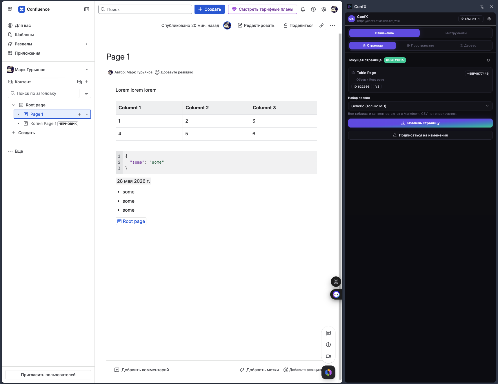
</p>

<details>
<summary><strong>Скриншоты возможностей</strong></summary>

### Плавающая кнопка

<p align="center">
  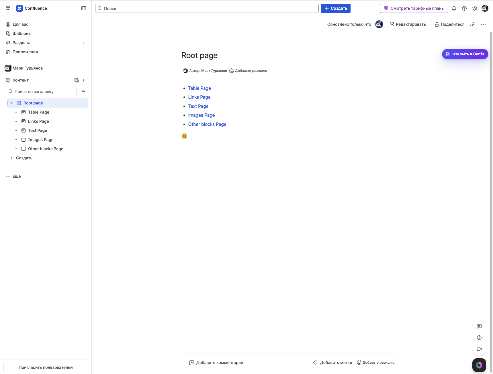
</p>

### Выгрузка страницы Confluence

<p align="center">
  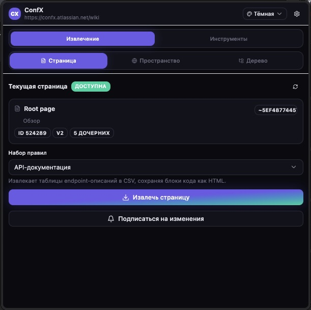
  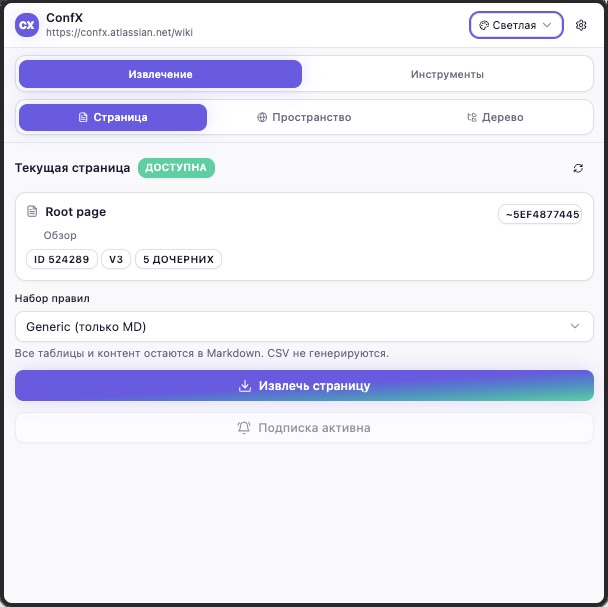
</p>

### Выгрузка пространства

<p align="center">
  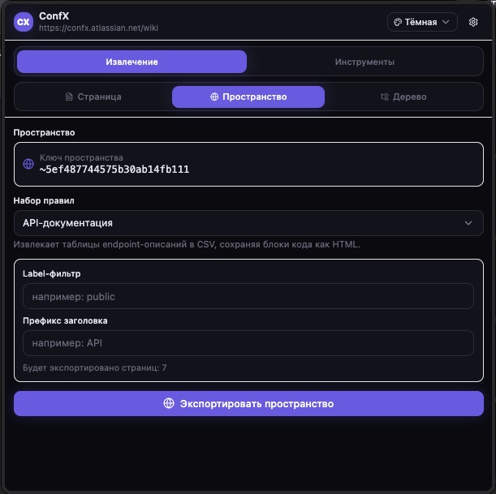
</p>

### Выгрузка поддерева

<p align="center">
  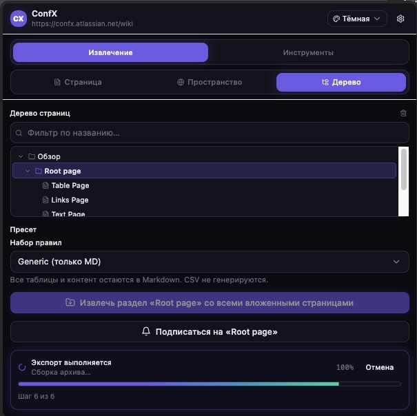
  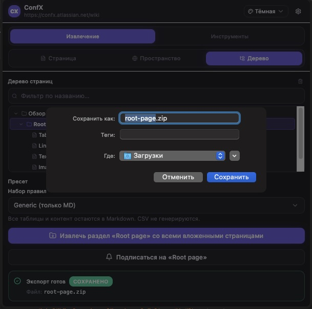
</p>

### Выгрузка Jira issue

<p align="center">
  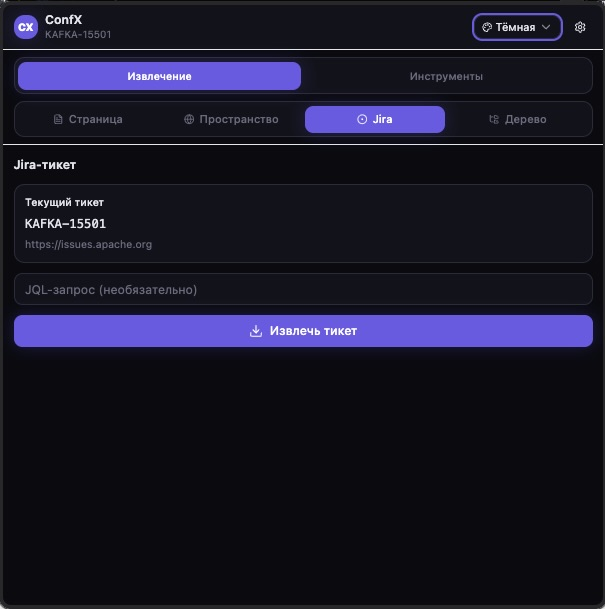
</p>

### Блок-пикер

<p align="center">
  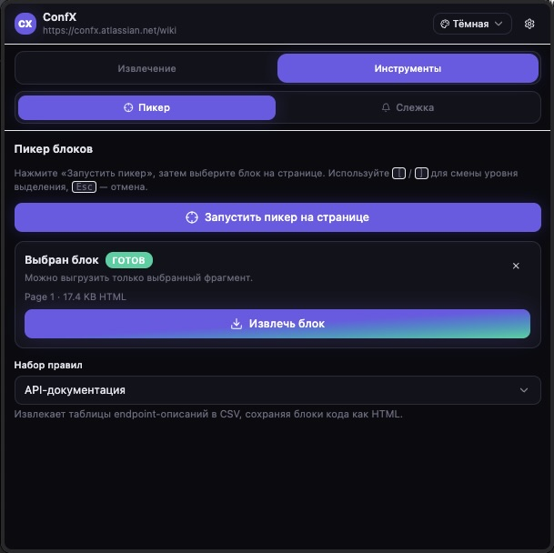
</p>

### Watch (экспериментально)

<p align="center">
  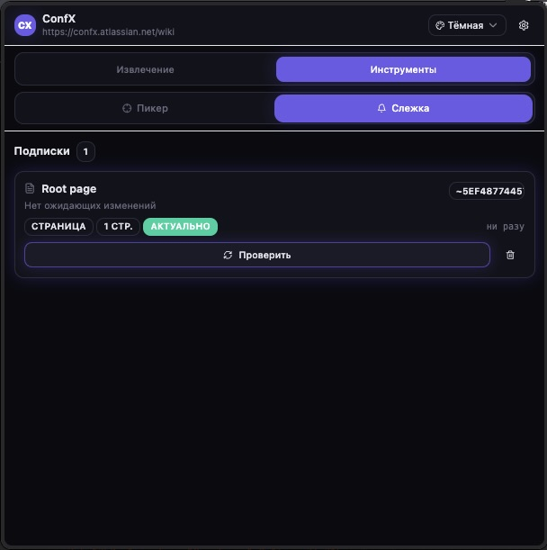
  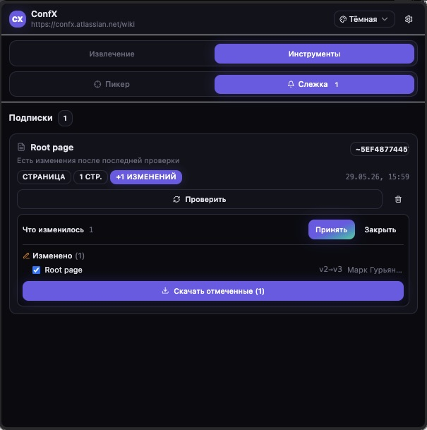
</p>

### Настройки и правила

<p align="center">
  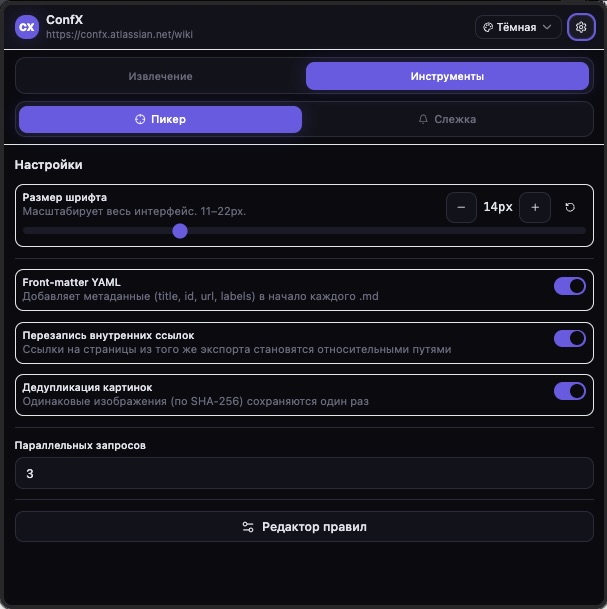
  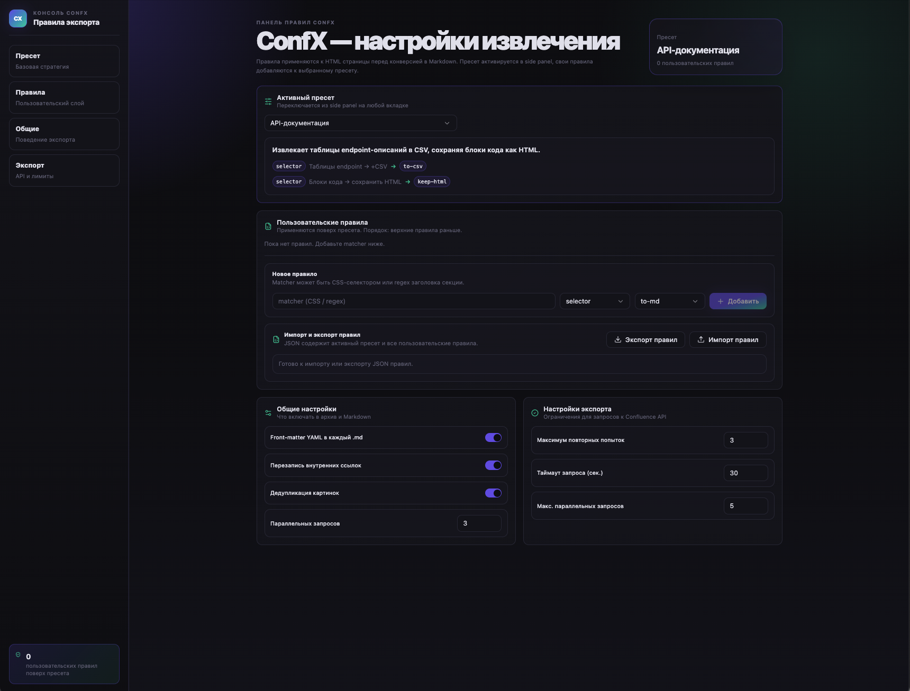
</p>

</details>

## Возможности

- **Page export**: выгрузка текущей страницы Confluence в Markdown, CSV-таблицы, изображения, комментарии и manifest.
- **Space export**: выгрузка всех страниц пространства Confluence, если текущий контекст это поддерживает.
- **Subtree export**: рекурсивная выгрузка дочерних страниц и генерация навигационного `README.md`.
- **Picker**: выбор блока на странице, предпросмотр и выгрузка только выбранного блока.
- **Watch** *(экспериментально)*: сохранение snapshots и просмотр изменений во времени.
- **Jira support**: извлечение содержимого Jira issue, если текущая вкладка открыта на задаче.
- **Rule engine**: настройка правил извлечения секций и таблиц под соглашения страниц Confluence.

## Определение страниц и плавающие кнопки

ConfX подключает content script к HTTP/HTTPS-страницам, но плавающая кнопка **Открыть в ConfX** показывается только когда страница распознана как Confluence или Jira.

- Confluence сначала определяется по Atlassian metadata, например `ajs-page-id`, затем по известным Confluence URL routes.
- Jira сначала определяется по `ajs-issue-key`, затем по известным маршрутам задач, например `/browse/KEY-123`.
- Обычные страницы, где в URL случайно встречается значение вроде `ABC-123`, игнорируются, чтобы уменьшить false positives.

Кнопку можно независимо отключить для Confluence и Jira в **Настройках**. Там же есть диагностика текущей вкладки: тип страницы, host, источник определения и состояние видимости кнопок.

## Хранение Watch-подписок

Watch-подписки хранятся локально в browser profile и не отправляются во внешний сервис.

- Область хранения: `chrome.storage.local`.
- Troubleshooting key: `cx.subscriptions.v1`.
- Каждая подписка хранит baseline snapshot и ограниченную локальную историю проверок.
- Принятие изменений обновляет baseline snapshot, но сохраняет недавнюю историю проверок.

Если проверка нашла добавленные или изменённые страницы, ConfX может выгрузить выбранные изменённые страницы в один ZIP с отчётом `watch-diff.json`. Удалённые страницы попадают в отчёт, но не скачиваются как контент.

## Безопасность и конфиденциальность

> ConfX читает содержимое Confluence и Jira через **cookies активной browser-сессии**. Отдельный Confluence или Jira API-токен не нужен.
>
> Development-сборки запрашивают **широкий HTTP/HTTPS host access** (`https://*/*`, `http://*/*`). Устанавливайте только доверенные release-артефакты и всегда сверяйте checksum с `SHA256SUMS` из того же GitHub Release.

## Установка из GitHub Releases

Публикация в Chrome Web Store сейчас намеренно не входит в scope. GitHub Releases -- канал распространения для текущего release flow.

### Chrome / Chromium

1. Скачайте `confx-chrome.zip` и `SHA256SUMS` из того же релиза.
2. Проверьте checksum: `sha256sum -c SHA256SUMS --ignore-missing`.
3. Распакуйте `confx-chrome.zip`.
4. Откройте `chrome://extensions`.
5. Включите **Developer Mode** (переключатель в правом верхнем углу).
6. Нажмите **Load unpacked**.
7. Выберите распакованную папку, в корне которой лежит `manifest.json`.

### Яндекс Браузер

1. Скачайте `confx-yandex.crx` и `SHA256SUMS` из того же релиза.
2. Проверьте checksum: `sha256sum -c SHA256SUMS --ignore-missing`.
3. Откройте `browser://tune`.
4. Перетащите `confx-yandex.crx` в окно браузера.

## Использование

### Выгрузка страницы Confluence

1. Откройте страницу Confluence в браузере.
2. Откройте side panel ConfX (нажмите на иконку ConfX в панели инструментов).
3. При необходимости выберите preset извлечения.
4. Нажмите **Export**.
5. Сохраните сгенерированный ZIP-файл.

### Выгрузка блока через picker

1. Откройте страницу Confluence в браузере.
2. Откройте side panel ConfX и нажмите **Launch picker**.
3. Наведите курсор на страницу, чтобы подсветить целевой блок. Используйте `[` / `]` для изменения уровня выделения. Нажмите `Esc` для отмены.
4. Кликните по блоку для выбора.
5. В side panel нажмите **Export block**.
6. Сохраните сгенерированный ZIP-файл.

### Выгрузка Jira issue

1. Откройте Jira issue в браузере.
2. Откройте side panel ConfX (нажмите на иконку ConfX в панели инструментов).
3. Нажмите **Export**.
4. Сохраните сгенерированный ZIP-файл.

## Системные требования

- **Node.js 22** (соответствует CI workflow).
- **npm** (поставляется с Node.js).
- **Chrome / Chromium** -- для локальных сборок и smoke-проверок.
- **Яндекс Браузер** -- для smoke-проверок Yandex CRX (опционально).
- **OpenSSL** -- для генерации локального Yandex signing key (опционально).

## Локальная разработка

```sh
npm ci
npm run dev
```

Chrome development build:

```sh
npm run build:chrome
```

Загрузите `dist/` через `chrome://extensions` с включённым Developer Mode.

Yandex development build требует локальный ключ подписи:

```sh
npm run gen:key:yandex
npm run release:yandex
```

Сгенерированный локальный ключ предназначен только для разработки, если команда явно не назначила его release-ключом.

## GitHub Actions distribution

Release workflow собирает оба артефакта и публикует их как workflow artifacts. Для тегов `v*` он также прикрепляет артефакты к GitHub Release.

Обязательные secret и release variable:

| Имя | Тип | Назначение |
|---|---|---|
| `YANDEX_CRX_PRIVATE_KEY_B64` | GitHub Actions secret | Base64-кодированный private signing key для `confx-yandex.crx`. |
| `YANDEX_EXTENSION_ID` | Workflow env / secret override | Ожидаемый Yandex extension ID |

Workflow записывает private key во временный файл, использует его только для Yandex build, валидирует вычисленный extension ID и удаляет файл в конце job.

## Поддержка браузеров

| Возможность | Chrome / Chromium | Яндекс Браузер |
|---|---|---|
| Manifest V3 | Поддерживается | Поддерживается |
| Основной UI | Side panel | Popup fallback / совместимый extension UI |
| `side_panel` в manifest | Есть | Есть для совместимости |
| `action.default_popup` | Не включается | Включается в Yandex target |
| Direct GitHub artifact | `confx-chrome.zip` | `confx-yandex.crx` |
| Стабильность extension ID | Зависит от install channel | Зависит от Yandex signing key |

## Проверка

### Локальная проверка (без приватных ключей)

```sh
npm ci
npm run typecheck
npm test
npm run build:chrome
```

### Полная release-проверка (требуется Yandex signing key)

```sh
npm run release:all
```

`release:all` требует `YANDEX_KEY_PATH` или локальный файл `keys/yandex.pem`.

Проверка корня Chrome ZIP:

```sh
python3 - <<'PY'
import zipfile

with zipfile.ZipFile('release/confx-chrome.zip') as archive:
    assert 'manifest.json' in archive.namelist()
PY
```

Manual browser smoke checks перед публичным релизом:

1. Загрузить `dist/` в Chrome и проверить side panel на 320-360px и 480px.
2. Установить `release/confx-yandex.crx` в Яндекс Браузере и проверить popup fallback.
3. Выгрузить одну страницу Confluence и убедиться, что ZIP содержит Markdown и manifest files.

## Диагностика проблем

| Проблема | Проверка |
|---|---|
| Chrome ZIP не устанавливается | Убедитесь, что архив распакован, а `manifest.json` лежит в корне выбранной папки. |
| Yandex release падает | Проверьте `YANDEX_KEY_PATH` или локальный `keys/yandex.pem`. |
| Yandex extension ID изменился | Проверьте signing key и `YANDEX_EXTENSION_ID`. Другой ключ создаёт другую extension identity. |
| Side panel обрезается | Используйте свежий релиз; узкие Chrome side panel layouts поддерживаются явно. |
| Export падает на странице | Проверьте, что вы залогинены в Confluence/Jira в том же browser profile. |
| Изображения или вложения отсутствуют | Проверьте, что browser session может открыть эти файлы напрямую. Auth, CORS, лимит размера или истёкшая сессия могут блокировать скачивание. |
| Кнопка появилась не на том сайте | Откройте Настройки и проверьте диагностику текущей вкладки. При необходимости отключите кнопки Confluence/Jira. |

## Структура проекта

```text
src/
  manifest.ts              # MV3 manifest через CRXJS
  background/              # service worker и routing browser UI
  content/                 # picker и injected page controls
  sidepanel/               # React side panel и popup UI
  options/                 # редактор rules/settings
  viewer/                  # Markdown viewer page
  lib/                     # extraction pipeline
  types/                   # shared TypeScript models
scripts/
  zip-chrome.mjs           # Chrome ZIP artifact
  pack-yandex.mjs          # signed Yandex CRX artifact
  checksums.mjs            # SHA256SUMS generation
```

## Статус

ConfX активно поддерживается как browser extension release flow. Chrome Web Store publishing запланирован отдельно и не входит в текущую автоматизацию.

## Лицензия

[MIT](LICENSE)
