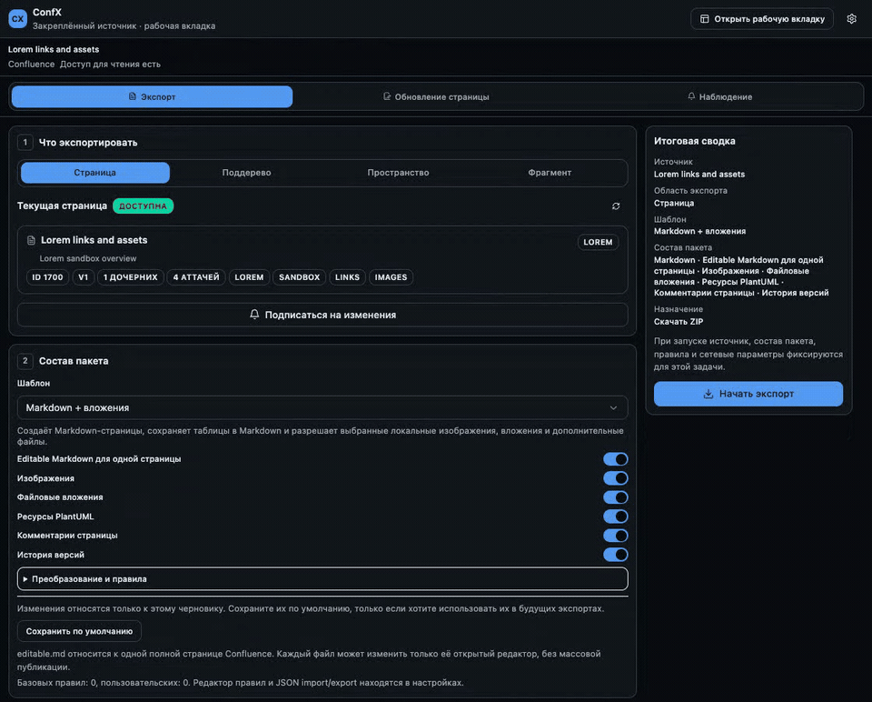
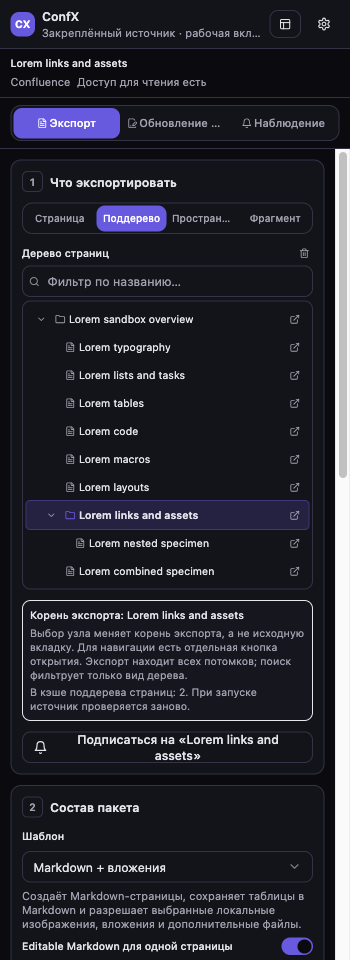

# ConfX

> Браузерное расширение для выгрузки Confluence и Jira в Markdown, CSV, изображения и ZIP-архивы. Работает через активную browser-сессию -- отдельный API-токен не нужен.


[English version](README.md)

| Поле              | Значение                                                     |
| ----------------- | ------------------------------------------------------------ |
| Статус            | Active                                                       |
| Тип               | Браузерное расширение / инструмент выгрузки host-страниц     |
| Host-браузеры     | Chrome / Chromium, Яндекс Браузер                            |
| Основной стек     | Manifest V3, React 18, TypeScript, Vite, Tailwind CSS |
| Release-артефакты | `confx-chrome.zip`, `confx-yandex.crx`, `SHA256SUMS`         |

<details>
<summary>Анимация экспорта</summary>

Настоящий экспорт поддерева в обычной рабочей вкладке, на изолированной Lorem-песочнице.
Это не запись native side panel или системного окна сохранения.



[Статичный снимок](docs/screenshots-ru/r2-workspace-ru.png)

</details>

## Что выгружает ConfX

ConfX записывает одинаковое содержимое пакета в скачиваемый ZIP, новую папку или ZIP напрямую на диск:

```text
confluence-page.zip
  index.md                 # single-page и block export остаются в корне архива
  manifest.json            # manifest v2: источник, страницы, outcomes и ошибки
  pages/
    123456/
      index.md             # watch-changed использует стабильные папки по page ID
      tables/
      images/
      attachments/
      comments.json
      history.json
```

- **Markdown** -- основное содержимое страницы или задачи, конвертированное из Confluence/Jira HTML.
- **CSV** -- извлечённые таблицы, по одному файлу на таблицу.
- **Изображения** -- inline-изображения, загруженные с хоста, с дедупликацией при включении.
- **Вложения** -- вложения страницы до настроенного лимита размера.
- **Комментарии** -- комментарии страницы и фрагментные (inline) комментарии с авторами, статусом разрешения, ответами и ссылками на вложения сохраняются в одном `comments.json`; `index.md` содержит только страницу, а файлы комментариев лежат в `attachments/comments/<comment-id>/`.
- **manifest v2** -- `manifest.json` (или `space-manifest.json` для экспорта пространства) сохраняет прежние тип экспорта, timestamp, preset, source и counts, а также содержит канонический список `pages`. Для каждой страницы записываются упорядоченные ancestors, parent ID, путь в архиве, origin и проверенные outcomes вложений. Ошибки list/download фиксируются без учёта отсутствующих файлов как сохранённых.

### Пресеты экспорта

- **Markdown + вложения** -- создаёт Markdown-страницы, оставляет таблицы в Markdown, скачивает inline-изображения и включает вложения страницы, если они разрешены настройками.
- **Только Markdown** -- создаёт Markdown-страницы и оставляет таблицы в Markdown. Изображения и файлы вложений не скачиваются.
- **Только CSV-таблицы** -- создаёт CSV для реальных пользовательских таблиц и служебный `index.md` со списком записанных CSV для каждой страницы. Читаемый текст страницы, editable-файлы, ресурсы, комментарии и история исключены.

### Точность читаемого Markdown

Отрендеренный HTML обрабатывается как HTML, а не переосмысливается как Jira wiki-разметка:
параметры маршрутов вроде `{code}` остаются буквальным текстом. PRE-блоки сохраняют весь
текст, соседние inline-code, переводы строк BR и значимые пробелы; явные метаданные языка
имеют приоритет над оформительскими CSS-классами. Буквальные XML/generics остаются текстом
в абзацах, ссылках и ячейках таблиц.
Обёртки `<p class="code-fence">` с CODE сохраняются как многострочный код; ссылки внутри него
остаются буквальным текстом. Кодовые блоки в GFM-таблицах используют экранированные HTML
PRE/CODE вместо невалидных вложенных fences, сохраняя переводы строк и отступы. Вложенный
CODE не добавляет видимых бэктиков. Версии npm-пакетов и email в обычном тексте не превращаются
в почтовые ссылки; явные HTML-ссылки остаются кликабельными.
Известные скрытые настройки расширений и collaboration-декорации исключаются без удаления
видимых JSON-примеров. Предпросмотр номеров заголовков добавляется только в читаемую проекцию.
Wiki-ссылки за пределы архива становятся абсолютными онлайн-URL, в том числе при отключённом
переписывании ссылок между страницами в локальные пути. Уже раздробленный код не склеивается по догадке.
Эти исправления читаемой проекции не меняют существующие editable-форматы v1/v2 и проверки
конфликтов при импорте.

## Автономная Lorem-песочница

Выполните `npm install` и `npm run sandbox`, затем откройте <http://127.0.0.1:4177/>.
Локальная лаборатория содержит синтетические страницы, настоящий self-hosted TinyMCE,
раздельные опубликованные версии и черновики, вложения, журнал преобразований, сброс
и сценарии конфликтов. Лимиты кодека: исходник 1,5 МиБ, глубина 128, 40k узлов, тела запросов
2 МиБ; задачи/макросы/ресурсы остаются непрозрачно защищёнными. Черновик сохраняет базовую
версию и никогда тихо не перебазируется на новую опубликованную.
Экспортируйте страницу или раздел и загружайте изменённый MD через настоящее распакованное
расширение Confx.
Рабочие экспорты, аккаунт Atlassian и Docker не требуются.

Это независимая реализация совместимого контракта, **не сервер Confluence**. Она не
подтверждает поведение конвертера Atlassian и произвольных Marketplace-плагинов.
Каталог компонентов, ограничения, лицензия TinyMCE и проверки `test:sandbox` /
`test:sandbox:e2e` описаны в [руководстве песочницы](sandbox/README.md).

### Только синтетические fixtures

`npm run check:privacy` проверяет авторские HTML/data-fixtures и примеры песочницы:
локальные home paths, реальные email, непустые token/cookie samples для аутентификации,
захваченные account metadata и внешние URL вне allowlist запрещены. Используйте независимые
Lorem-примеры, зарезервированные example-домены или loopback; публичные XML namespaces
и PlantUML endpoints разрешены узким списком. Проверка выводит только места и коды правил,
без найденных значений.
Это guard текущих fixtures, а не доказательство чистоты Git-истории, медиа и release-архивов.
Реальные снимки страниц и credentials нельзя помещать в fixtures, заметки и отчёты.

## Рабочая область и владелец задания

- **Экспорт**, **Обновление страницы** и **Наблюдение** — независимые разделы.
  В экспорте доступны Страница, Поддерево, Пространство, Фрагмент и формы Jira Задача/Поиск.
- Для каждой вкладки-источника, продукта и канонического base URL хранится отдельный
  черновик. Переход на другую страницу того же источника обновляет карточку, не сбрасывая
  выбранный scope, корень дерева, фильтры и раскрытые узлы. Выбор строки дерева меняет
  корень экспорта; отдельная кнопка **Открыть … во вкладке-источнике** переходит на wiki-страницу.
- Метаданные рабочей области переживают перезагрузку UI в пределах browser session.
  Загруженный editable-файл и diff остаются в памяти открытого UI при смене разделов,
  а не в workspace/job snapshots. После закрытия или перезагрузки UI файл выбирается заново.
- Одно задание экспорта пакета удерживает общий lock расширения до завершения скачивания
  и очистки. Его статус виден во всех разделах. Другой UI может посмотреть статус и
  **Перейти к заданию**, но отменять его может только живой владелец. Закрытие/перезагрузка
  владельца вызывает best-effort abort; потеря владельца означает **interrupted**, не автопродолжение.
- **Открыть рабочую вкладку** создаёт обычную вкладку расширения с привязкой к текущему
  источнику. Без явной допустимой привязки она не подхватывает произвольную активную wiki
  и не запускает экспорт. Потеря доступа к источнику не сбрасывает сохранённый черновик.
- Production **Export Composer** следует порядку **что → состав пакета → куда →
  сводка → Начать экспорт**. Параметры пакета общие для областей, недоступные выключены
  с объяснением; отдельных пресетов и виджетов задания в формах областей нет.
- В panel доступен быстрый одностраничный ZIP. Многостраничный запуск и оба назначения
  на диск предлагают **Продолжить в рабочей вкладке**. Новая обычная вкладка восстанавливает
  метаданные, не живую задачу и не выбранный файл; проверьте черновик и запустите экспорт там.
  Потерянный источник заменяется только явным выбором открытой исходной вкладки.



### Три назначения и отмена

- **Скачать ZIP** удерживает сжатые chunks в памяти и открывает окно сохранения браузера
  после упаковки. **Экспорт готов** означает завершение загрузки браузером, не только
  получение download ID. После передачи браузеру отмена вызывает `downloads.cancel`;
  оставшееся открытым окно сохранения иногда нужно закрыть вручную.
- **Новая папка** вызывает native picker родительского каталога до асинхронного извлечения
  в обычной рабочей вкладке. Создаётся свежий `<safe-actual-package-root>-<job-UUID>`,
  существующий экспорт не очищается и не переиспользуется. `.confx-export.json` содержит
  running/terminal status и сырые счётчики подтверждённых файлов/байтов. Отмена или ошибка
  прекращает новые записи, по возможности abort текущего writable; уже закрытые файлы
  остаются с cancelled/failed marker. Рекурсивного удаления и rollback нет. Пакет с ошибками
  необязательных ресурсов имеет partial marker; `running` после потери владельца — незавершённый экспорт.
- **ZIP на диск** вызывает native picker родительской папки до асинхронного извлечения
  в обычной рабочей вкладке. В ней создаётся новый `<safe-actual-package-root>-<job-UUID>.zip`:
  имя берётся из фактического корня пакета, сообщённого producer, а не подсказки черновика.
  ZIP записывается с backpressure; **Экспорт готов** появляется только после завершения
  encoder, всех записей и close writable. Отмена или ошибка может оставить новый ZIP
  незавершённым; он не удаляется и не объявляется готовым. Если файл или папка с
  сгенерированным именем уже существует, возникает destination collision до открытия
  writable: существующие объекты не переиспользуются, не очищаются и не перезаписываются.
- Оба ZIP используют общий fflate ZIP32 encoder. Консервативные пределы без sentinel
  значений: 65 534 записи и `0xfffffffe` байт для ZIP size/offset counters; превышение
  даёт явный `ZIP_LIMIT_EXCEEDED`. У папки нет искусственного ZIP32-ограничения.
  Отказ доступа, отмена picker, отсутствие API и writer errors не подменяют назначение.

Для записи на диск нужны secure context обычной extension tab и соответствующий API.
OPFS-автоматизация проверяет реальные handles/writables, но не доказывает работу native
OS dialogs. Область native-приёмки этого кандидата указана в разделе поддержки браузеров.

Streamed ZIP намеренно не использует `showSaveFilePicker`. Нормативный алгоритм
[спецификации WICG File System Access](https://wicg.github.io/file-system-access/#api-showsavefilepicker)
очищает выбранный существующий файл до возврата его handle. Это не специфичная для
Vivaldi ошибка; abort последующего writable не отменяет этот шаг picker.
Выбор родительской папки и создание нового ZIP с уникальным именем исключает сам
выбор старого файла. Обычное **Скачать ZIP** по-прежнему открывает окно сохранения браузера.

У браузерного API нет атомарного exclusive create. UUID, проверка существования и
export lock расширения предотвращают переиспользование в заданиях Confx, но не дают
гарантии против внешнего процесса, создающего то же сгенерированное имя между проверкой и созданием.

### Последовательная запись и полнота пакета

Страницы Confluence подготавливаются и записываются по одной. После успешной записи
остаются только подтверждённые метаданные страниц и assets; обычный ZIP download также
хранит сжатый результат. Это не обещание памяти размером в один файл: конвертер удерживает
текущую страницу и её ресурсы.

При включённой дедупликации обычные изображения и вложения с одинаковыми bytes и extension
используют первый фактический путь. Коллизии имён получают разные безопасные пути; файлы
разных комментариев и пары исходник/изображение PlantUML остаются раздельными. Ссылки на
уже записанные страницы и текущую подготовленную страницу могут быть локальными. Ссылки
вперёд, на ещё не подтверждённые страницы, остаются онлайн; записанный Markdown впоследствии
не переписывается.

Исчерпание попыток получить страницу останавливает задание: неполный ZIP не предлагается
как готовая выгрузка. Ошибка или превышение размера отдельного ресурса может дать partial
пакет; ссылка остаётся онлайн, пропуск фиксируется в manifest. Отмена охватывает также
очередь запросов, ожидание повторной попытки и чтение тела ответа.

Страницы пространства/метки и дочерние страницы читаются до пустого ответа, в том числе
после коротких пачек; повторная выдача ID — ошибка пагинации, а не успешное завершение.
Обходы дерева и Watch больше не останавливаются молча на 5 000 дочерних страницах.
Jira search сохраняет прежний предел одной страницы из 50 задач и aggregate Markdown/JSON/CSV.

## Параметры по умолчанию и разовый экспорт

Шаблон экспорта задаёт начальную политику, а не команду перезаписать настройки.
Параметры видны в **Составе пакета**, настройки преобразования раскрываются в
**Преобразовании и правилах**; глубина показана для поддерева/пространства.
Изменения относятся к текущему черновику; **Сохранить по умолчанию** — отдельное действие.
Подготовленный запуск фиксирует source, rules и network options и не меняется вслед за настройками.

- **Markdown + вложения** разрешает выбранные ресурсы и сопутствующие файлы.
- **Только Markdown** выключает изображения, вложения и PlantUML assets. Editable-файл,
  комментарии и история остаются отдельными параметрами.
- **Только CSV-таблицы** создаёт CSV и служебный `index.md` со ссылками на CSV этой страницы,
  без читаемого текста страницы, editable-файла, ресурсов, комментариев и истории.
- Пустая глубина — без ограничения; ноль — только корень поддерева. Параллельность
  обхода дерева и параллельность HTTP-запросов — разные лимиты.
- **Фрагмент** для любого продукта не включает editable, вложения страницы, комментарии
  и историю. Доступные изображения и PlantUML assets зависят от шаблона. Jira Задача/Поиск
  использует описание, комментарии и вложения; ссылки на задачи остаются онлайн, без
  Confluence page-link rewriting. Tables-only для Jira — CSV метаданных задач и индекс.

Schema v6 сохраняет миграцию v4→v5 прежних export options в `exportDefaults`, custom rules
и отсутствие старого неработавшего ограничения глубины. Только v5→v6 добавляет цветовую
схему, не пересоздавая export defaults. Rules JSON version 1 сохраняет
фактические base/custom rules; прежние versionless Options exports принимаются на входе.
ID импортируемого preset не заменяет его правила. Дополнительный Confluence base URL
допустим только для origin и path источника; иначе остаётся detected base с диагностикой.
В online viewer ресурсы сохраняют сетевые адреса, а не ссылки на несуществующие файлы архива.

### Единственная поверхность настроек

Кнопка **Настройки** в header открывает options page, не четвёртый рабочий раздел:
**Значения экспорта по умолчанию**, **Внешний вид и язык**, **Кнопка на страницах**,
свёрнутые **Дополнительно: сеть и правила** и **Диагностика**. Advanced сохраняет раздельные
лимиты discovery/HTTP, retries/timeout, same-origin base override, редактор custom rules
и JSON import/export правил.

В оформлении два независимых выбора: **Светлая / Тёмная / Системная** и **Фиолетовая /
Синяя / Лесная / Графитовая / Янтарная** схема. Карточки показывают реальные цвета интерфейса.
Изменения без перезагрузки применяются к workspace, настройкам, viewer и launcher,
но не к самой wiki. Системная тема следует ОС только при явном выборе этого режима.
Прежние Светлая/Тёмная сохраняются с Фиолетовой схемой; default — Тёмная + Фиолетовая.
При ошибке сохранения остаётся прежний выбор, можно повторить попытку.

Иконка панели браузера — плоский знак «документ → экспорт», отдельно отрисованный для
16–64 px. Она сразу меняется вместе с режимом и палитрой. Для Системной темы разрешение
`offscreen` нужно лишь для первоначального чтения темы ОС; скрытая страница сразу закрывается.
Живые обновления без polling приходят из видимой HTTP(S)-вкладки с content script Confx
или видимого окна ConfX. Если открыты только внутренние страницы браузера, тема обновится
при открытии подходящей страницы.
В списке установленных расширений браузера остаётся статичная Тёмная + Фиолетовая иконка.

Отчёт выгружается только кнопкой **Выгрузить безопасную диагностику**. Видимый состав:
версии расширения/манифеста, возможности API, статус/фаза экспорта и код причины из
разрешённого списка. Тела страниц, URL/ID источника, названия, имена файлов, файлы,
правила, содержимое настроек, headers, credentials и исходные ошибки не выгружаются.

## Доработка страницы локально в Markdown

1. Откройте wiki-страницу Confluence **в режиме редактирования**, затем ConfX → **Обновление страницы**.
2. Нажмите **Экспортировать MD для правки**. Скачается один `.editable.md`: без JSON-снимков,
   распаковки ZIP, DevTools и отдельного стенда.
3. Доработайте файл в IDE. Сохраните скрытые комментарии `confx:`: в них находятся
   исходный HTML редактора и привязки блоков для сохранения макросов и оформления.
4. Выберите изменённый MD или перетащите его в область загрузки в **Обновлении страницы**.
   Нажмите **Применить в редактор**, затем **Подтвердить применение** внутри Confx.
   Правки применяются одним отменяемым действием, без системного диалога подтверждения.
5. Опубликуйте правки обычной кнопкой **Сохранить / Обновить** на странице. Применение
   настоящих изменений может включить автосохранение черновика; Confx не публикует автоматически.

Выбор файла выполняется локально без доступа к сайту; применение требует соответствующего
исходного редактора. Смена вкладки/base/page очищает файл и подтверждение, не предлагая
применить правки другой страницы.

В Web Panels Vivaldi системное окно выбора файла может не открываться из-за регрессии
[VB-133104](https://forum.vivaldi.net/topic/122145/side-panel-cannot-access-the-file-picker-dialog./4).
Нажмите **Выбрать файл во вкладке**, выберите файл в обычной вкладке и выполните diff/
confirm/apply там же. Открытие вкладки не вызывает picker автоматически; File и HTML
не передаются обратно через session storage. Drag-and-drop остаётся быстрым способом
там, где работает. Доступ к файловым URL и отключение безопасности браузера не нужны.

Переход доступен в native-панелях и popup. Возможности файловой системы рабочей вкладки
получает только настоящая обычная вкладка браузера; скрытая pseudo-tab панели Vivaldi
не считается рабочей вкладкой.

Экспорт и загрузка файла не меняют редактор. Файл без правок — пустая операция.
Если файл относится к другой странице/сайту или редактор изменился после экспорта,
обновление отклоняется, а не затирает более новые правки. Пробных изменений и временных страниц нет.

Этот сценарий работает с TinyMCE-редактором Confluence (`wysiwygTextarea_ifr`), в том
числе для wiki-страниц, открытых из Jira; поля Jira-задач он не изменяет. Применение
editable Markdown ограничено одним уже открытым редактором, не массовой публикацией.

Поддерживаются обычные Markdown-правки: текст, выделение и inline-код, безопасные ссылки,
уровни заголовков, добавление/удаление абзацев, списки, строки/столбцы таблиц и язык fenced-кода.
Сохраняйте служебные комментарии `confx:`, даже удаляя всё содержимое обычного блока.
Новый Markdown можно вставлять и между блоками, не создавая вручную новые идентификаторы.
Нетронутые участки исходника, защищённые макросы и скрытые настройки сохраняются побайтово.
Простые правки меняют исходный HTML точечно; структурные пересобирают только изменённый
обычный блок с сохранением совместимых исходных атрибутов. Правки защищённых макросов,
небезопасный HTML, повреждение/перестановка идентификаторов и неоднозначные изменения
через границы исходного оформления отклоняются без частичного применения.
Храните файл конфиденциально: в нём есть документ целиком. Общий лимит — 35 МиБ,
редактируемого Markdown — 5 МиБ.

Новые файлы из открытого редактора используют `confx-editor-markdown/2` с исходным пакетом
`confx-roundtrip/2`. Буквальный текст безопасно экранируется, а разбор служебных границ
сохраняет значимые пробелы, NBSP, табуляцию и отступы кода. Сохраняйте обрамляющие пустые
строки вокруг комментариев идентификаторов.
Файлы с объявленной v1 читаются с исходными проверенными baseline и mapping. Для новой
проекции выгрузите страницу заново; защищённая v1-таблица не переосмысливается автоматически.
Структуры с меткой `[Confx protected …]` остаются защищёнными, включая самостоятельные
списки и таблицы с объединёнными ячейками. Новый список можно добавить в редактируемый блок
или промежуток, но при повторном экспорте самостоятельный список станет защищённым.

### Редактируемые файлы в полных ZIP-выгрузках

Экспорт страницы, поддерева, пространства и изменившихся страниц может добавлять
**`editable.md`** рядом с обычным **`index.md`** для обоих Markdown-шаблонов, если параметр
включён и безопасен. Выгрузка читает опубликованное содержимое: не открывает редакторы,
не создаёт черновики и не публикует страницы.

1. Распакуйте ZIP и доработайте `editable.md` нужной страницы, а не её `index.md` для чтения.
2. Сохраните скрытые комментарии `confx:`. Каждый редактируемый файл самодостаточен:
   его можно переносить независимо от архива.
3. Откройте эту страницу в режиме редактирования и загрузите или перетащите файл в
   **Обновление страницы**. Просмотрите diff, примените и подтвердите правки, затем
   опубликуйте их штатной кнопкой Confluence.

Новые файлы массового экспорта используют **`confx-storage-markdown/2`**; объявленная v1
также поддерживается. В них находятся оригинальный `body.storage`, идентификатор страницы,
опубликованная версия и SHA-256; доверенные привязки заново строятся из исходника при загрузке.
Обычные абзацы, заголовки, таблицы и pre/code-блоки используют точечное Markdown-редактирование.
Простые прямоугольные таблицы с TH-шапкой или явно выделенной жирным TD-шапкой редактируются
с сохранением исходных TD/TH, обёрток выделения, классов и атрибутов фона. Атрибуты предпросмотра
автонумерации и скрытые настройки остаются в исходнике, а не превращаются в буквальные номера
заголовков редактируемого Markdown.
Содержимое layout-ячеек можно менять без пересборки обёрток. Неизвестные конструкции,
Confluence-макросы (в том числе code), ресурсные ссылки/изображения, самостоятельные списки
и таблицы с объединёнными ячейками защищены. Неоднозначные вставки между layout-ячейками
или контейнерами отклоняются. Нетронутые участки Storage при локальном патче сохраняются побайтово.

Перед применением Storage-файла Confx проверяет опубликованную версию и исходник,
затем сравнивает открытый черновик с этой базой через преобразование в контексте страницы.
Предлагаемый HTML редактора должен преобразоваться обратно в полную ожидаемую структуру
Storage, включая параметры макросов. Потеря данных или неподдерживаемая сервером конвертация
блокирует обновление; остаётся доступна прямая выгрузка открытого редактора. Перед записью
повторно проверяется содержимое живого редактора. Запросы конвертации не сохраняют
и не публикуют страницу. Файл без правок никогда не меняет редактор.

Полный исходник **не** вкладывается при любом включённом правиле удаления содержимого
или таблицы после извлечения CSV, даже если селектор сейчас ничего не находит.
CSV-only и экспорт фрагмента не получают обратимые файлы. Отсутствие идентификатора,
версии или исходника, некорректный/небезопасный XML также исключают файл, не прерывая
обычную выгрузку для чтения. В manifest v2 поле `editable` каждой страницы содержит
версию метаданных, доступность, путь/хеш исходника либо причину:
`filtered-content`, `partial-export`, `source-unavailable` или `invalid-source`.
Лимит исходного Storage и редактируемого Markdown — по 5 МиБ, полного файла — 35 МиБ.
Это массовый **экспорт**, а не автоматическая публикация раздела.

Обновление расширения не меняет ранее скачанные ZIP. Чтобы получить исправленный читаемый
Markdown и редактируемые файлы v2, выгрузите раздел заново.

## Возможности

- **Page export**: выгрузка текущей страницы Confluence в Markdown, CSV-таблицы, изображения, комментарии и manifest.
- **Page layouts**: сохранение стандартных Confluence layouts и экспортных маркеров; editable sidecars сохраняют защищённый исходник для одностраничной правки редактора.
- **Space export**: выгрузка всех страниц пространства Confluence, если текущий контекст это поддерживает.
- **Subtree export**: рекурсивная выгрузка дочерних страниц и генерация навигационного `README.md`.
- **Picker**: выбор блока на странице, предпросмотр и выгрузка только выбранного блока.
- **Watch** _(экспериментально)_: сохранение snapshots и просмотр изменений во времени.
- **Jira support**: извлечение содержимого Jira issue, если текущая вкладка открыта на задаче.
- **Rule engine**: настройка правил извлечения секций и таблиц под соглашения страниц Confluence.

## Граница одностраничного обновления

В ConfX нет массовой публикации Markdown, publisher для создания/обновления страниц,
загрузки вложений при импорте или rollback публикации. Массовое чтение и экспорт
поддерева/пространства сохранены; editable sidecars применяются по одному к подходящему
открытому редактору. Публикует только пользователь кнопкой самого Confluence.
Read-only преобразование storage/editor может использовать POST — это не REST-запись
опубликованного содержимого.

Старые recovery-записи под ключом `cx.import.run.v1` в `chrome.storage.local` не читаются,
не возобновляются и не удаляются автоматически. Это может быть единственная запись
о прежней частичной публикации; её нужно разбирать приватно, а не уничтожать.

## Определение страниц и плавающие кнопки

ConfX подключает content script к HTTP/HTTPS-страницам, но плавающая кнопка **Открыть в ConfX** показывается только когда страница распознана как Confluence или Jira.

- Confluence сначала определяется по Atlassian metadata, например `ajs-page-id`, затем по известным Confluence URL routes.
- Jira сначала определяется по `ajs-issue-key`, затем по известным маршрутам задач, например `/browse/KEY-123`.
- Обычные страницы, где в URL случайно встречается значение вроде `ABC-123`, игнорируются, чтобы уменьшить false positives.

Компактную кнопку можно перетащить (порог 6px); она закрепляется у ближайшего края
с отступом 12px и остаётся в viewport. **Enter** открывает ConfX, **Shift+F10** или
контекстный клик открывает меню, **Esc** закрывает его. Можно скрыть кнопку до перезагрузки
вкладки, скрыть на сайте или сбросить позицию. SPA rerender не отменяет скрытие во вкладке.

**Настройки → Кнопка на страницах** содержит live global toggles Confluence/Jira и
локальное восстановление/сброс сайтов. Видимость и позиция сайтов хранятся в
`storage.local` под `cx.launcher.v1`, не в sync. Восстановление сохраняет позицию, сброс
удаляет override, но не отменяет скрытие во вкладке до reload. Toolbar и рабочая вкладка доступны.

## Хранение Watch-подписок

Watch-подписки хранятся локально в browser profile и не отправляются во внешний сервис.

- Область хранения: `chrome.storage.local`.
- Troubleshooting key: `cx.subscriptions.v1`.
- Каждая подписка хранит baseline snapshot и ограниченную локальную историю проверок.
- Принятие изменений обновляет baseline snapshot, но сохраняет недавнюю историю проверок.

Если найдены добавленные/изменённые страницы, ConfX выгружает выбранные страницы с общими package/destination options и отчётом `watch-diff.json`. Из panel нужно перейти в рабочую вкладку и снова открыть «Наблюдение» для сохранённого выбора. Удалённые страницы только перечисляются, их содержимое не загружается.
Изменённые страницы сохраняются как `pages/<page-id>/index.md`, поэтому две страницы не могут перезаписать один Markdown или asset path.

## Безопасность и конфиденциальность

> ConfX читает содержимое Confluence и Jira через **cookies активной browser-сессии**. Отдельный Confluence или Jira API-токен не нужен.
>
> Development-сборки запрашивают **широкий HTTP/HTTPS host access** (`https://*/*`, `http://*/*`). Устанавливайте только доверенные release-артефакты и всегда сверяйте checksum с `SHA256SUMS` из того же GitHub Release.
>
> ConfX не выполняет injection во внутренние страницы браузера, например `chrome://extensions`. Если Chrome удерживает доступ к HTTP(S)-сайту, side panel сохраняет URL-based detection и предлагает по действию пользователя запросить только точный origin текущей вкладки. Error recovery никогда не расширяет запрос до всех HTTP/HTTPS-сайтов.
>
> Отрендеренный Markdown во viewer-е санитизируется до пассивного HTML, правки редактора внедряются только в подтверждённый браузером документ открытого редактора Confluence, а console-логи не содержат URL ресурсов, названий вложений и сырых ошибок.

## Установка из GitHub Releases

Публикация в Chrome Web Store сейчас намеренно не входит в scope. GitHub Releases -- канал распространения для текущего release flow.

### Chrome / Chromium

1. Скачайте `confx-chrome.zip` и `SHA256SUMS` из того же релиза.
2. Проверьте checksum: `sha256sum -c SHA256SUMS --ignore-missing`.
3. Распакуйте `confx-chrome.zip`.
4. Откройте `chrome://extensions`.
5. Включите **Developer Mode** (переключатель в правом верхнем углу).
6. Нажмите **Load unpacked**.
7. Выберите распакованную папку, в корне которой лежит `manifest.json`.

### Яндекс Браузер

1. Скачайте `confx-yandex.crx` и `SHA256SUMS` из того же релиза.
2. Проверьте checksum: `sha256sum -c SHA256SUMS --ignore-missing`.
3. Откройте `browser://tune`.
4. Перетащите `confx-yandex.crx` в окно браузера.

## Использование

### Выгрузка страницы Confluence

1. Откройте страницу Confluence в браузере.
2. Откройте side panel ConfX (нажмите на иконку ConfX в панели инструментов).
3. Выберите **Экспорт → Страница**, проверьте шаблон/пакет и назначение **Скачать ZIP**.
4. Нажмите **Начать экспорт**.
5. Сохраните ZIP и дождитесь статуса **Экспорт готов**.

### Выгрузка блока через picker

1. Откройте страницу Confluence в браузере.
2. Откройте ConfX → **Экспорт → Фрагмент** и запустите picker на странице.
3. Наведите курсор на страницу, чтобы подсветить целевой блок. Используйте `[` / `]` для изменения уровня выделения. Нажмите `Esc` для отмены.
4. Кликните по блоку для выбора.
5. Проверьте пакет и назначение, затем нажмите **Начать экспорт**.
6. Сохраните ZIP или перейдите в рабочую вкладку для назначения на диск.

### Выгрузка Jira issue

1. Откройте Jira issue в браузере.
2. Откройте side panel ConfX (нажмите на иконку ConfX в панели инструментов).
3. Выберите **Экспорт → Задача**, проверьте пакет и назначение, нажмите **Начать экспорт**.
4. Сохраните ZIP. **Поиск** использует JQL и продолжается в обычной рабочей вкладке.

## Системные требования

- **Node.js 22.12 или новее** (требование Vite 7; соответствует CI workflow).
- **npm** (поставляется с Node.js).
- **Chrome / Chromium** -- для локальных сборок и smoke-проверок.
- **Яндекс Браузер** -- для smoke-проверок Yandex CRX (опционально).
- **Существующий Yandex signing key** — нужен только для подписи CRX; unsigned builds используют закреплённую публичную identity.

## Локальная разработка

```sh
npm install
npm run dev
```

Chrome development build:

```sh
npm run build:chrome
```

Загрузите `dist/` через `chrome://extensions` с включённым Developer Mode.

Unsigned Yandex development build использует существующую закреплённую public identity:

```sh
npm run build:yandex
```

Для signed packaging нужны существующий private signing key (`YANDEX_KEY_PATH` либо
локальный `keys/yandex.pem`) и настроенный `YANDEX_EXTENSION_ID`. Не генерируйте и не
подменяйте ключ ради обхода отсутствующего prerequisite: это меняет extension identity.
Публичный ключ манифеста не является credential.

### Границы экспортных модулей

`src/lib/export/confluence.ts` и `jira.ts` отвечают за оркестрацию содержимого.
`package-writer.ts` задаёт состав пакета, `zip-encoder.ts` объединяет fflate-упаковку,
а `paths.ts` — безопасные имена в архиве. Producers возвращают результат без импортов
React или UI скачивания. Контракты progress callbacks находятся в `export/contracts.ts`;
метаданные источника, отображение прогресса и передача браузеру (`sidepanel/download.ts`)
остаются ответственностью UI. ZIP собирается из сжатых chunk parts без повторной
конкатенации и копирования всего архива.

## GitHub Actions distribution

`0.3.0` — текущий стабильный релиз. См. [changelog](CHANGELOG.md) и
[release checklist](CONTRIBUTING.md#release-checklist) для следующего.

Release workflow сначала проверяет стабильную числовую версию `X.Y.Z`, равенство
версий package/lock и точное совпадение тега `vX.Y.Z`, включая ручной запуск на теге.
Затем reusable R2 verification выполняет privacy, typecheck, unit/sandbox contracts,
lint/format, свежий Chrome build с actual-extension E2E и unsigned Yandex build.
Ручной запуск на ветке ограничен verification и Chrome-артефактом; совпадающий тег
также включает Yandex signing и публикацию GitHub Release. Tag/push/release требуют
отдельного разрешения; наличие workflow не доказывает прохождение remote checks.

Обязательные secret и release variable:

| Имя                          | Тип                            | Назначение                                                      |
| ---------------------------- | ------------------------------ | --------------------------------------------------------------- |
| `YANDEX_CRX_PRIVATE_KEY_B64` | GitHub Actions secret          | Base64-кодированный private signing key для `confx-yandex.crx`. |
| `YANDEX_EXTENSION_ID`        | Workflow env / secret override | Ожидаемый Yandex extension ID                                   |

Private key нужен только signed Yandex packaging. Job записывает существующий ключ во временный файл, проверяет вычисленный extension ID и удаляет файл при завершении. Без signing material CRX packaging блокируется, новый ключ вместо него не создаётся.

## Поддержка браузеров

| Возможность               | Chrome / Chromium          | Яндекс Браузер                            |
| ------------------------- | -------------------------- | ----------------------------------------- |
| Manifest V3               | Поддерживается             | Поддерживается                            |
| Основной UI               | Side panel                 | Popup fallback / совместимый extension UI |
| `side_panel` в manifest   | Есть                       | Есть для совместимости                    |
| `action.default_popup`    | Не включается              | Включается в Yandex target                |
| Direct GitHub artifact    | `confx-chrome.zip`         | `confx-yandex.crx`                        |
| Стабильность extension ID | Зависит от install channel | Зависит от Yandex signing key             |

Native-приёмка этого цикла R2 пройдена в **Vivaldi на macOS**: три назначения, настоящая
native-панель → workspace → OS input → diff → подтверждённое применение только в редактор,
unchanged-file и явный отказ native write permission. Это не означает покрытие OS dialogs
Chrome/Yandex: оба target по-прежнему собираются, actual-extension suite Chrome
проверяет реальные OPFS.

## Проверка

### Автоматические R2 gates

```sh
npm install
npm run check:privacy
npm run typecheck
npm test
npm run test:sandbox
npm run build:chrome
npm run test:sandbox:e2e
npm run build:yandex
npm run lint
npm run format:check
npm run release:chrome
```

Это обязательные gates, не заявление об их успешном выполнении в текущей копии.

### Полная release-проверка (требуется Yandex signing key)

```sh
npm run release:all
```

`release:all` требует `YANDEX_KEY_PATH` или локальный файл `keys/yandex.pem`.

Проверка корня Chrome ZIP:

```sh
python3 - <<'PY'
import zipfile

with zipfile.ZipFile('release/confx-chrome.zip') as archive:
    assert 'manifest.json' in archive.namelist()
PY
```

Ручная приёмка перед публичным релизом:

1. Собранное расширение и loopback Lorem-песочница на 320, 350, 600 и 1120px, клавиатура и обе темы.
2. В обычной extension tab Vivaldi (выбранный оператором браузер этого цикла) проверить реальные OS pickers родительской папки для обоих disk destinations: отмену/отказ доступа, читаемый новый UUID ZIP после close и отмену без изменения существующих файлов и без статуса готовности незавершённого нового ZIP. Проверить отказ при коллизии с существующим файлом или папкой без переиспользования. Native-dialog coverage Chrome/Yandex в этом цикле не требуется и не заявляется.
3. Поддерево с editable во все три назначения; чтение Markdown/ресурсов офлайн, локальная Lorem-правка и применение в нужном редакторе без публикации. Conflict/unchanged и неизменённое published content.
4. Vivaldi Web Panel → **Выбрать файл во вкладке** → native input → diff → apply. Live cancel при смене раздела и owner closure/interrupted.
5. Launcher drag/hide/SPA/restore, loopback-only request logs, layouts архивов и отсутствие Confx REST writes опубликованной страницы.
6. Отдельный private artifact/media audit, включая OCR и визуальную проверку новых Lorem-снимков. Build, screenshot и OPFS handles сами по себе не закрывают эти gates.

## Диагностика проблем

| Проблема                             | Проверка                                                                                                                                     |
| ------------------------------------ | -------------------------------------------------------------------------------------------------------------------------------------------- |
| Chrome ZIP не устанавливается        | Убедитесь, что архив распакован, а `manifest.json` лежит в корне выбранной папки.                                                            |
| Yandex release падает                | Проверьте `YANDEX_KEY_PATH` или локальный `keys/yandex.pem`.                                                                                 |
| Yandex extension ID изменился        | Проверьте signing key и `YANDEX_EXTENSION_ID`. Другой ключ создаёт другую extension identity.                                                |
| Пустая иконка после пересборки распакованного расширения | Откройте `chrome://extensions` (Vivaldi: `vivaldi://extensions`), найдите ConfX и нажмите **Обновить**. Пересборка `dist/` не перезагружает установленную копию. Удалять и устанавливать расширение заново не нужно. |
| Side panel обрезается                | Используйте свежий релиз; узкие Chrome side panel layouts поддерживаются явно.                                                               |
| Export падает на странице            | Проверьте, что вы залогинены в Confluence/Jira в том же browser profile.                                                                     |
| Изображения или вложения отсутствуют | Проверьте, что browser session может открыть эти файлы напрямую. Auth, CORS, лимит размера или истёкшая сессия могут блокировать скачивание. |
| Кнопка появилась не на том сайте     | В Настройках → Кнопка на страницах скройте сайт или выключите соответствующий global toggle; toolbar/рабочая вкладка доступны. |

## Структура проекта

```text
src/
  manifest.ts              # MV3 source of truth; собственный plugin vite.config.ts генерирует manifest.json
  background/              # service worker и routing browser UI
  content/                 # picker и injected page controls
  sidepanel/               # React side panel и popup UI
  options/                 # редактор rules/settings
  viewer/                  # Markdown viewer page
  lib/                     # extraction pipeline
  types/                   # shared TypeScript models
scripts/
  zip-chrome.mjs           # Chrome ZIP artifact
  pack-yandex.mjs          # signed Yandex CRX artifact
  checksums.mjs            # SHA256SUMS generation
```

## Статус

ConfX поддерживается как браузерное расширение с распространением через GitHub Releases. Публикация в Chrome Web Store не входит в текущий workflow. Node.js нужен для сборки; расширение работает в браузере.

## Лицензия

[MIT](LICENSE)
